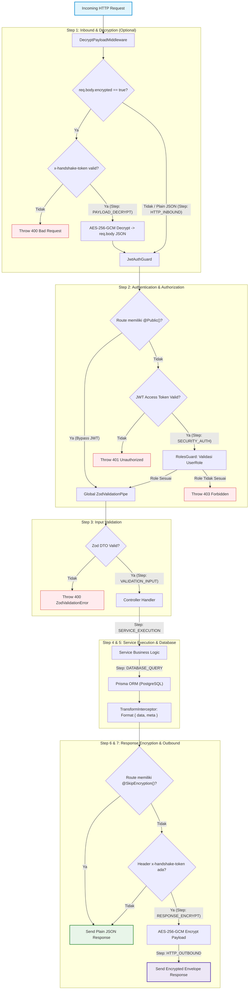

# MenuScan Backend System Architecture Specification

> **Project**: MenuScan – Digital QR Code Menu System  
> **Backend Framework**: NestJS (TypeScript)  
> **Database & ORM**: PostgreSQL & Prisma ORM  
> **Validation & Schema**: Zod & `nestjs-zod`  
> **Security & Auth**: Dual JWT (Access + Refresh Token) & ECDH AES-256-GCM Payload Encryption  
> **Logging**: Structured Step-Tracing Logger (`nestjs-pino`)  
> **Document Location**: `docs/architecture/architecture-design.md`  
> **Detailed API Contract & Checklist**: [`docs/architecture/api-contract-and-security-guidelines.md`](api-contract-and-security-guidelines.md)  

---

## 🏛️ 1. Architectural Pattern & Design Principles

Arsitektur aplikasi ini dibangun dengan mengadopsi **Feature-Based Modular Architecture** sesuai panduan resmi *NestJS Best Practices*. 

### Prinsip Utama:
1. **High Cohesion, Low Coupling**: Setiap domain bisnis (Auth, Categories, Menus, Attendance, Settings, Staff, Tables, Orders, Reports) diisolasi dalam modulnya masing-masing.
2. **Single Responsibility Principle (SRP)**:
   - **Controller**: Hanya menangani HTTP routing, ekstraksi request, dan pemanggilan service.
   - **Service**: Menangani seluruh *business logic* dan interaksi dengan database (Prisma).
   - **DTO (Zod)**: Bertanggung jawab atas kontrak dan validasi tipe data *input/output*.
3. **Layered Lifecycle Pipeline**: Keamanan (Enkripsi/Deskripsi), Otentikasi (JWT), Validasi (Zod), dan Logging dipisahkan secara tegas pada layer *Middleware*, *Guard*, *Pipe*, *Interceptor*, dan *Exception Filter*.
4. **Zero-Trust Hybrid Encryption**: Seluruh endpoint (baik Public maupun Protected) mendukung response encryption & body decryption otomatis saat `x-handshake-token` dikirimkan (lihat [Panduan API Contract](api-contract-and-security-guidelines.md)).

---

## 📁 2. Complete Directory Structure (`src/`)

```text
src/
├── config/                      # Pengelolaan & Validasi Environment Variable (.env)
│   ├── env.config.ts            # Schema Zod untuk validasi .env
│   └── app.config.ts            # Konfigurasi aplikasi (Port, JWT Secret, Key Expiry)
│
├── common/                      # Module & Utilitas Bersama (Cross-Cutting Concerns)
│   ├── crypto/                  # Kriptografi & Handshake Service
│   │   ├── crypto.service.ts    # AES-256-GCM Encrypt/Decrypt & HKDF Derivation
│   │   ├── ecdh.service.ts      # Pertukaran kunci ECDH (prime256v1)
│   │   └── crypto.module.ts
│   ├── decorators/              # Custom Decorators
│   │   ├── public.decorator.ts       # @Public() -> Bypass JwtAuthGuard
│   │   ├── skip-encrypt.decorator.ts# @SkipEncryption() -> Bypass Payload Encryption
│   │   └── current-user.decorator.ts# @CurrentUser() -> Extract req.user
│   ├── filters/                 # Global Exception Handling
│   │   ├── global-exception.filter.ts # Tangkap ZodError, HttpException, & PrismaError
│   │   └── http-exception.filter.ts
│   ├── guards/                  # Security Guards
│   │   ├── jwt-auth.guard.ts     # Memeriksa Access Token
│   │   ├── jwt-refresh.guard.ts  # Memeriksa Refresh Token saat /auth/refresh
│   │   └── handshake.guard.ts    # Memeriksa Keberadaan x-handshake-token
│   ├── interceptors/            # Response Transformation & Encryption
│   │   ├── encrypt-payload.interceptor.ts # Enkripsi Response JSON
│   │   └── transform.interceptor.ts       # Standarisasi JSON Response Wrapper
│   ├── logger/                  # Step-Tracing Logger Module (nestjs-pino)
│   │   ├── logger.module.ts     # Pino Logger & Redaction Setup
│   │   └── logger.service.ts    # Utility untuk Step Logging
│   ├── middlewares/             # Request Decryption
│   │   └── decrypt-payload.middleware.ts  # Deskripsi Request Body sebelum masuk Pipe
│   └── prisma/                  # Database Singleton Module
│       ├── prisma.service.ts    # Lifecycle Connection Hook & Slow Query Logging (>500ms)
│       └── prisma.module.ts     # @Global() Module
│
├── modules/                     # Domain Feature Modules
│   ├── auth/                    # Modul Otentikasi & Handshake
│   │   ├── dto/                 # Zod Schemas (LoginDto, HandshakeDto, RefreshTokenDto)
│   │   ├── strategies/          # Passport Strategies (JwtStrategy, JwtRefreshStrategy)
│   │   ├── auth.controller.ts
│   │   ├── auth.service.ts
│   │   └── auth.module.ts
│   ├── categories/              # Modul Pengelolaan Kategori
│   │   ├── dto/                 # Zod Schemas (CreateCategoryDto, UpdateCategoryDto)
│   │   ├── categories.controller.ts
│   │   ├── categories.service.ts
│   │   └── categories.module.ts
│   └── menus/                   # Modul Pengelolaan Menu & Status Availability
│       ├── dto/                 # Zod Schemas (CreateMenuDto, UpdateMenuDto, QueryMenuDto)
│       ├── menus.controller.ts
│       ├── menus.service.ts
│       └── menus.module.ts
│
├── app.module.ts                # Root Application Module
└── main.ts                      # Entry Point & Bootstrap Pipeline Setup
```

---

## 🔄 3. Request & Response Lifecycle Flow (Step-Tracing)

Berikut adalah alur perjalanan HTTP Request terenkripsi yang dicatat langkah demi langkah (*step-by-step*) oleh sistem logging:



---

## 🛠️ 4. Spesifikasi Layer Teknis

### A. Database Layer (`PrismaModule` & PostgreSQL)
- **Tipe Modul**: `@Global()` agar `PrismaService` dapat langsung di-inject tanpa re-import.
- **Connection Management**: `onModuleInit()` dan `onModuleDestroy()` untuk *graceful shutdown*.
- **Indexing & Soft Delete**: Rincian lengkap strategi query, indexing, dan soft delete tersedia di [database-strategy.md](file:///d:/code/be-menu-scan-latihan/docs/architecture/database-strategy.md).

### B. Logging Layer (`nestjs-pino`)
- **Step-Tracing Engine**: Menempelkan `requestId` (UUID) & `step` tag pada setiap layer eksekusi.
- **Redaction Rules**: Mengenkripsi/menyembunyikan field sensitif (`password`, `payload`, `iv`, `tag`, `authorization`, `refreshToken`).
- Rincian lengkap tersedia di [logging-strategy.md](file:///d:/code/be-menu-scan-latihan/docs/architecture/logging-strategy.md).

### C. Security & Authentication Layer
1. **Dual JWT Token Strategy**:
   - **Access Token**: Berisi `userId`, `email`, `role`. Masa berlaku 15 menit. Disahkan oleh `JwtStrategy`.
   - **Refresh Token**: Berisi `userId`. Masa berlaku 7 hari. Disimpan ter-hash di DB (`User.refreshToken`). Disahkan oleh `JwtRefreshStrategy` pada endpoint `/api/v1/auth/refresh`.
2. **ECDH Payload Encryption Layer**:
   - `DecryptPayloadMiddleware`: Berjalan sebelum Guard & Controller. Membaca `x-handshake-token` untuk mengambil `SessionKey` dari Cache/Memory.
   - `EncryptPayloadInterceptor`: Interceptor global yang menangkap return value Controller dan membungkusnya menjadi ciphertext terenkripsi.

### D. Validation Layer (`nestjs-zod`)
- Menggunakan `ZodValidationPipe` menggantikan `class-validator`.
- Keuntungan Zod:
  - Tipe data TypeScript otomatis diturunkan dari Schema (`z.infer<typeof Schema>`).
  - Integrasi otomatis ke `@nestjs/swagger` untuk pembuatan OpenAPI Docs interaktif.

### E. Global Exception Handling Layer (`GlobalExceptionFilter`)
Menangkap error dan mencatat log dengan `step: "EXCEPTION_CATCH"`. Format response error terstandar:
```json
{
  "statusCode": 400,
  "error": "Bad Request",
  "message": "Validation failed",
  "details": [
    {
      "field": "price",
      "message": "Price must be greater than 0"
    }
  ],
  "timestamp": "2026-08-06T09:47:00.000Z"
}
```

---

## 🔗 5. Terhubung ke Dokumen Terkait

- 📄 Wireframe API & Blueprint Schema: [wireframe-api-not-final.md](file:///d:/code/be-menu-scan-latihan/docs/wireframe/wireframe-api-not-final.md)
- 📄 Spesifikasi Enkripsi Payload: [encryption-decryption-strategy.md](file:///d:/code/be-menu-scan-latihan/docs/security/encryption-decryption-strategy.md)
- 📄 Spesifikasi Step-Tracing Logging: [logging-strategy.md](file:///d:/code/be-menu-scan-latihan/docs/architecture/logging-strategy.md)
- 📄 Spesifikasi Database & Query Strategy: [database-strategy.md](file:///d:/code/be-menu-scan-latihan/docs/architecture/database-strategy.md)
